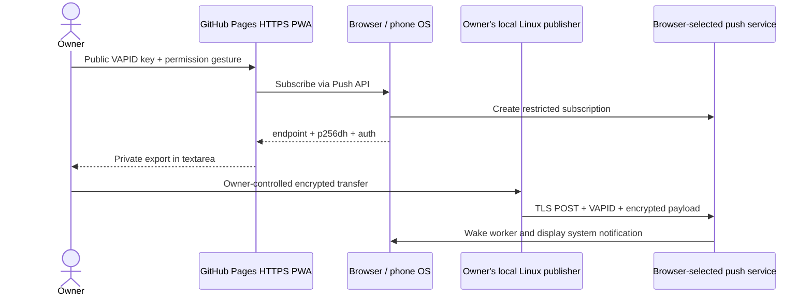

# Smart Smoker Web Push Test

Temporary public research prototype for real system notifications on locked iPhone
and Android devices. **No real phone delivery has been verified yet.**

- Site: https://mkopal.github.io/smart-smoker-push-test/
- Repository: https://github.com/mkopal/smart-smoker-push-test
- Static EN/CS enrollment PWA on GitHub Pages; no application backend or upload API.
- Local Linux CLI publisher using integrity-locked `web-push` 3.6.7.
- No Home Assistant, paid notification provider or third-party notification app.
- Browser/vendor push infrastructure and internet connectivity are still required.



The PWA does not need to stay open to receive push. This is a platform capability,
not a successful-device-test claim. See the
[WebKit platform announcement](https://webkit.org/blog/13966/webkit-features-in-safari-16-4/)
and [Google's overview](https://web.dev/articles/push-notifications-overview).
The laptop is the publisher here; ESP32 implementation remains a separate unverified
milestone. This experiment never contacts or configures a smoker.

## Local setup and checks

Requirements: Linux/POSIX file permissions, Git, Node.js 22+ with matching npm,
Python 3.10+ (standard library only). `.nvmrc` records Node 22.21.0 for optional nvm.
No npm packages run in the browser; the npm tree is local development tooling only.

```bash
git clone https://github.com/mkopal/smart-smoker-push-test.git
cd smart-smoker-push-test
# If using nvm, run: nvm install && nvm use
node --version
npm --version
npm ci --ignore-scripts --no-audit --no-fund
npm test
npm run test:library
python3 -m unittest discover -s tests -v
python3 build.py
python3 scripts/audit_public.py
```

`npm test` exercises publisher, browser enrollment, localization and worker fixtures
without network access. `test:library` verifies real encryption/decryption, wrong-auth
rejection, ES256 JWT signatures and private CLI lifecycle offline. It never sends to
a real push endpoint. Python tests cover build boundaries, discovered catalogs,
ignored private files and public audit regressions. `npm ci` checks lock integrity;
it is not a dependency vulnerability audit. Chromium is optional for an actual browser
smoke test, with no permission grant, subscription creation or push send:

```bash
node scripts/browser-test.cjs
node scripts/browser-test.cjs https://mkopal.github.io/smart-smoker-push-test/
```

The browser test uses a temporary profile and headless Chromium with its sandbox
disabled for CI-style test environments; run it only for this reviewed site. It is
a desktop smoke test, not Safari/Android acceptance or proof of locked-phone delivery.

## First iPhone test

On the Linux publisher, from this checkout, generate **development-only** credentials.
The contact URI is public VAPID identification, not a secret or backend handler.
`init` refuses to overwrite an existing file.

```bash
umask 077
mkdir -p local/private
chmod 700 local/private
node publisher.cjs init local/private/vapid.json https://github.com/mkopal/smart-smoker-push-test
node publisher.cjs public local/private/vapid.json
```

1. Use an iPhone with iOS 16.4+; record exact model, OS and Safari version. In Safari
   open **https://mkopal.github.io/smart-smoker-push-test/**.
2. Share → Add to Home Screen, then launch **the new Home Screen icon**. An ordinary
   Safari tab is not the supported iPhone enrollment context. Retain `standalone` mode.
3. Select Czech or English. Paste only the **public** key printed by `public`, tap
   Allow notifications and register, then grant the system permission prompt.
4. Tap Export. Keep the full export private and transfer it to your Linux computer
   using an owner-controlled encrypted channel. Never use a public paste, GitHub issue,
   chat, URL or screenshot containing the export. Do not paste the private signing key
   into the phone. Clipboard/cloud clipboard behavior is part of your transfer risk.
5. On Linux, create the private subscription file with the command below. Paste the
   exported JSON into stdin, then press Ctrl+D. Use a private terminal without recording.

```bash
python3 -c 'import os,sys; fd=os.open("local/private/iphone.json",os.O_WRONLY|os.O_CREAT|os.O_EXCL,0o600); f=os.fdopen(fd,"w"); f.write(sys.stdin.read()); f.close()'
```

6. First send a foreground baseline. Then switch to another app and repeat. Test
   locking separately: lock the iPhone, wait five minutes, then run this again.

```bash
node publisher.cjs send local/private/vapid.json local/private/iphone.json
```

7. Observe the actual system notification on Lock Screen/Notification Center; record
   test ID, send/display times and latency. Record sound separately, including mute,
   Focus and notification settings. Tap the notification and check it opens this PWA.
   No custom sound or critical-alert override is promised.
8. Repeat locked-screen trials three times with distinct IDs and with phone Wi-Fi
   disabled/mobile data active. The CLI computer still needs internet connectivity.

The CLI prints HTTP 201 acceptance **without claiming phone delivery**. Do not mark
a test PASS until you actually observe the intended phone notification.

## First Android test

1. Use a compatible current browser such as Chrome; record phone/OS/browser versions.
   Open the same HTTPS URL. Install/Add to Home Screen if offered. Installation is
   optional for Chrome Web Push; verify the exact installed/browser context used.
2. Select language, enter the same public VAPID key, register using the button and
   allow browser/system notification permissions. Export the separate subscription.
3. Transfer it privately and create a separate local file, paste JSON, then Ctrl+D:

```bash
python3 -c 'import os,sys; fd=os.open("local/private/android.json",os.O_WRONLY|os.O_CREAT|os.O_EXCL,0o600); f=os.fdopen(fd,"w"); f.write(sys.stdin.read()); f.close()'
node publisher.cjs send local/private/vapid.json local/private/android.json
```

4. Run foreground, background and locked-screen tests separately. Lock, wait five
   minutes, send and observe notification/sound/tap behavior. Repeat three times and
   over mobile data. Record battery optimization, notification-channel and silent/DND
   settings; do not disable browser security controls to make a test pass.

## Results and failure matrix

All phone outcomes start **NOT RUN**. Keep raw exports and screenshots private. Record
date/time/timezone, commit from `build-info.json`, model, OS/browser, installed/tab
context, locale, permission/Focus/battery settings, phone/publisher network, provider
result, notification ID, actual display time, sound and tap result. Publish only
sanitized PASS/FAIL/NOT RUN findings in [VALIDATION.md](VALIDATION.md).

| Scenario | Procedure | Expected observation to check |
|---|---|---|
| Foreground EN/CS | Send once per language; re-export after changing locale | Visible system notification with correct ID/time/language |
| Background | Switch to another app; send after 2 minutes | Notification without the enrollment document active |
| Locked | Lock, wait 5 minutes, send; repeat 3 times | Lock Screen/Notification Center notification; sound measured separately |
| Closed document | Close window; retain iPhone installed app; send | Worker/OS handles push without an open document; record closure method |
| Force-stop/swipe away | Test independently of ordinary backgrounding | Record actual suppression/recovery; no delivery guarantee after force-stop |
| Mobile data | Phone Wi-Fi off, publisher online, lock/send | Delivery does not require the phone's LAN or HA access |
| Phone offline | Airplane mode; send; reconnect within 30 s | Check possible queued delivery within TTL; no latency guarantee |
| TTL exceeded | Repeat offline and reconnect after >90 s | Expired test should not arrive; document unexpected late presentation |
| Publisher offline | Disconnect publisher, send, restore, manually send new test | Bounded sanitized error, no automatic replay queue |
| Focus/silent/power saving | Enable separately and repeat | Record visible/sound restrictions without claiming a bypass |
| Permission revoked | Disable permission, send, reopen page | No unauthorized display; re-pair/settings recovery; immediate 410 not guaranteed |
| Remove subscription | Use Remove, send old file, re-enroll | Old export no longer useful; replace it privately |
| Two phones | Send each export while both locked | Each intended phone, independent locale/key material |
| Key rotation | New key file; unsubscribe and enroll with new public key | Old-key mismatch rejected, new export works; every recipient needs migration |

Initial phone acceptance target: baseline/background/locked/closed/mobile-data/locale/
multiple-recipient scenarios pass on both phones, including three ordinary locked
trials displayed within 60 s each. This is a research threshold, not an SLA. Publish
all limitations and investigate failures; fixture/browser smoke success cannot satisfy
this gate. After testing, remove subscriptions in the PWA and delete their local
private files using normal owner file management. Uninstall only this experimental app.

## Publisher behavior and privacy

The publisher sends one semantic test event with a random ID, time and exported
recipient locale. TTL 60 seconds, high urgency, 10-second socket timeout; no automatic
retry, persistent queue, sensor readings or temperature alarm. Socket timeout is not
a global delivery deadline. Notification tags can replace a card with the same ID,
not provide exactly-once delivery or guaranteed sound deduplication.

Exit 0: provider accepted (201), not phone-confirmed. Exit 3: invalid subscription
(404/410), remove private export and enroll again. Exit 4: temporary failure (429/5xx),
retry manually after suitable backoff within useful event lifetime. Exit 5: authentication
(401/403), check key/contact/system clock. Exit 1: invalid input/network/other failure.
Response bodies, tokens and endpoints are suppressed. No debug flag dumps secrets.
The restricted hostname list covers Apple push subdomains, FCM and Mozilla's standard
endpoint. Other legitimate providers require a reviewed code/test update.

Changing language requires a new export/private file; existing files keep the prior
locale. Export uses the actual subscription's application-server public key, not the
current input text. Browser storage deletion/app removal/provider expiry can invalidate
subscriptions. VAPID rotation needs a new subscription restricted to the new key.

## Static hosting and installation limits

`python3 build.py` packages only `dist/`. The workflow tests first, audits the exact
public file inventory and uploads **only `dist/`**; the deploy job has Pages/OIDC
permissions, not publisher credentials. GitHub Pages is not a Node/Python application
server. The public repository includes CLI source for local use, but no CLI endpoint
is hosted. See [GitHub's workflow requirements](https://docs.github.com/en/pages/getting-started-with-github-pages/using-custom-workflows-with-github-pages).

Relative assets, worker registration, manifest ID/start_url/scope and notification
click target support `/smart-smoker-push-test/`. The worker's scope is that project
path, not `/`. A separate stable origin/path needs fresh enrollment/migration.
`build-info.json` records the build commit without exposing private inputs.

HTTPS provides a secure context on Pages. Loopback `localhost` is only a desktop
development exception. The worker has no fetch/cache handler, so opening/reloading
the enrollment page offline is deliberately unsupported. This does not mean the PWA
must remain foregrounded for push. iOS Home Screen installation and Android installer
promotion are browser/OS behavior requiring physical tests. Actual Focus, force-stop,
sound and inactive-site policies vary. Network/OS/provider failures can prevent delivery.

Read [SECURITY.md](SECURITY.md), the exact [public file list](PUBLIC_FILES.txt),
[licensing/provenance notes](NOTICE.md) and [validation evidence](VALIDATION.md).
